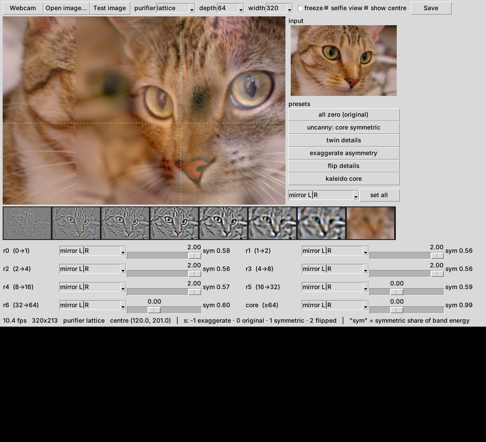
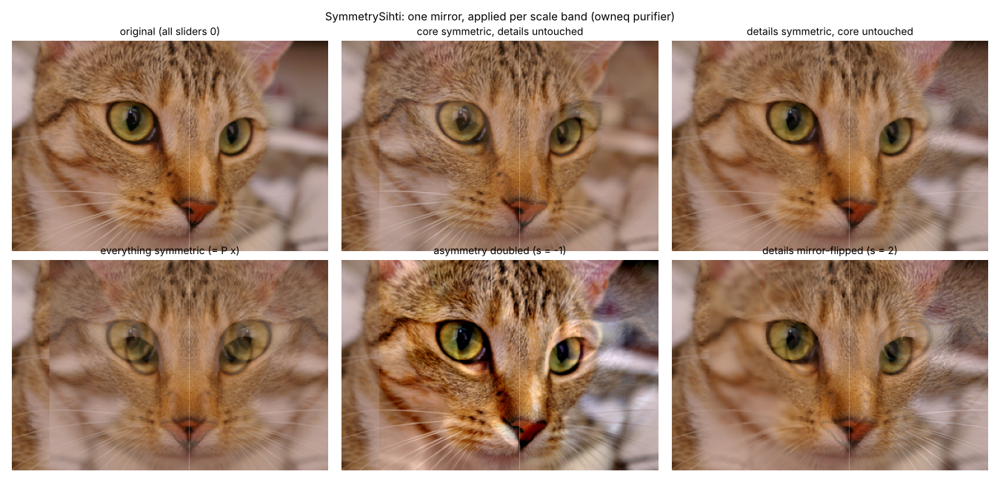
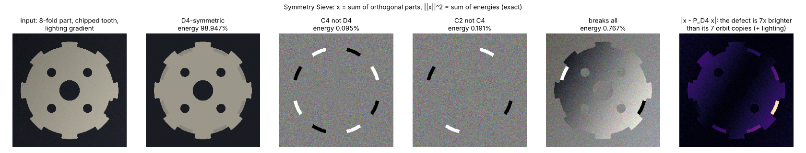
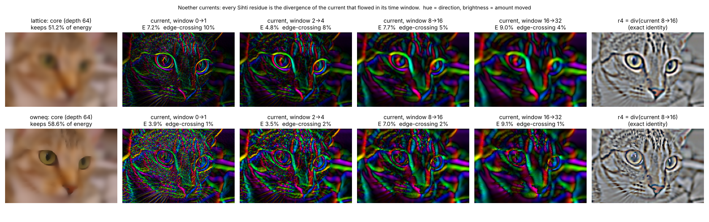

# SymmetrySihti

**A symmetry slider for every scale band of an image.** It uses the Sihti sieve: purify the image step by step, keep everything that bleeds out, and sum it back exactly. Each band gets its own symmetry operator and its own strength.



```
pip install -r requirements.txt
python symsihti_live.py            # webcam (falls back to a test image)
python symsihti_live.py photo.jpg
python demo.py photo.jpg --center CY CX --purifier lattice   # gallery figure, no webcam
python -m pytest tests
```

Left-click the output to put the symmetry centre there (e.g. between the eyes). Right-click resets it.

## What it does

1. **Sieve.** Run a purifier and keep the residues at octave depths 0, 1, 2, 4 … d_max. With r_k = x_{d_k} − x_{d_{k+1}}, we have `x = r_0 + r_1 + … + core`, exactly (reconstruction error ~1e-16).
   - `lattice`: heat flow on the plain pixel grid. Persistence means scale. Fast (~10 fps at 320 px).
   - `owneq`: heat flow on the image's own colour-affinity graph. Object layout survives in the core, and the texture inside objects bleeds into the residues (Sihti's G4 result). ~7 fps.
2. **Symmetry per band.** Each band r gets `P r + (1 − s)(r − P r)`, where P averages over a symmetry group about the chosen centre.

| s | effect |
|---|---|
| −1 | the band's asymmetry is doubled |
| 0 | unchanged (all zeros = the exact original) |
| 1 | the band becomes fully symmetric |
| 2 | the symmetry-breaking part is flipped; for a mirror, this is exactly the band's mirror image |

Groups: mirror L|R, mirror T|B, rotate 180, both mirrors (D2), rotate 90 (C4), kaleido (D4).

3. **"sym" readout.** For each band, it shows the share of the band's energy that is symmetric, ‖P r‖² / ‖r‖². Because P is an exact orthogonal projector, this energy split is exact, not an estimate.


The two purifiers treat the same slider very differently, because they put different things into the detail bands:



With `lattice`, the eyes live in the detail bands, so "details mirror-flipped" paints one eye's sharp detail onto the other eye's blurred base. With `owneq`, the eyes are objects and stay in the core, so the same setting barely touches them.

## What is exact (tests/, 66 tests)

- Lossless sieve for both purifiers.
- The own-EQ flow conserves mass, so every residue band has zero mean, and the core carries the image's mean colour.
- Every projector satisfies P² = P and Pᵀ = P to 1e-12, for any centre (integer or half-integer). Pixels whose symmetry orbit leaves the image are left untouched as whole orbits. That is what keeps P an exact projector, and it is why a visible seam appears where the mirror runs out of image.
- Strength 2 on a mirror is exactly the mirror image.
- Symmetrizing *every* band equals symmetrizing the whole image, since P is linear. The effects only come from treating the bands *differently*.
- Only square-lattice symmetries are offered (mirrors, 90° and 180° rotations), because only these map pixels exactly onto pixels. 5- or 7-fold symmetry would need resampling and would no longer be exact.

## Honest scope

Mirror and kaleidoscope filters and Laplacian/diffusion pyramids are all old. What this repo adds is the combination: a lossless, object-aware residue stack (Sihti) with an exact symmetry projector applied per scale band, plus an exact energy readout per band. It is a toy and an instrument, not a discovery.

## Part B: Symmetry Sieve and Noether currents

```
python noether_sieve_live.py            # webcam, or: python noether_sieve_live.py photo.jpg
python demo_b.py                        # figures, no webcam
```

Part A puts a symmetry on the image. Part B asks the Noether question: what does a symmetry of the *dynamics* conserve, and where does the conserved quantity go? It has two layers.

### B1. Symmetry Sieve: a Sihti whose purifiers are nested symmetry groups

For a chain G₀ ⊃ G₁ ⊃ … ⊃ {e} (e.g. D4 ⊃ C4 ⊃ C2 ⊃ 1), the group averages are nested orthogonal projectors. The sieve's parts c₀ = P₀x and c_k = P_k x − P_{k−1}x are therefore *exactly orthogonal*, and

  x = Σ c_k,  ‖x‖² = Σ ‖c_k‖²   (Parseval error 0 to machine precision; plain Sihti is lossless but not Parseval).

c_k is the part that has symmetry G_k but not the bigger G_{k−1}, which is the isotypic decomposition of representation theory. Nesting needs every orbit to stay inside the frame, so the sieve runs on the largest window centred on the chosen centre (square for chains with 90° rotations).



On a synthetic 8-fold part with a chipped tooth and a lighting gradient, the split is D4 98.965% / C4-not-D4 0.092% / C2-not-C4 0.185% / breaks-all 0.758%. Without the defect it is 99.327 / 0.016 / 0.033 / 0.624.

- A single defect shows up at **all 8 orbit positions** in every non-trivial level, because an isotypic split is global.
- The defect is located by |x − P x|, which is 7× larger at the true defect than at its 7 orbit copies.
- The lighting gradient dominates the "breaks all" energy, so this is not yet a defect detector without lighting normalisation.

### B2. Noether currents: the Sihti purifier written as a conservation law

The purifier is heat flow on a weighted pixel graph (`lattice`: all weights 1; `owneq`: weights from the image's own colour differences).
- **Symmetry:** adding a constant to a connected component commutes with the flow.
- **Conserved charge:** the colour mass of each component.
- **Local form:** a continuity equation, x_{t+1} = x_t − div J_t, with J_t(i→j) = τ w_ij (x_i − x_j). Hence

  **r_k = x_{d_k} − x_{d_{k+1}} = div( Σ_{t in window k} J_t )**   (tested to 1e-12)

**Every Sihti residue is exactly the divergence of the current that flowed during its time window.** The residue stack is a record of where the charge went.

**Energy ledger:** ‖f₀‖² = Σ E_k + ‖f_core‖² with every E_k ≥ 0, for the fluctuation f = x − mean. The mean is the global charge and never dissipates; on the cat it is 92% of the total energy.



Measured on the cat image, at depth 64 and width 240:

| | lattice | owneq |
|---|---|---|
| share of current crossing strong colour edges, per window | 10, 8, 8, 6, 5, 4, 3 % | 1, 1, 2, 2, 2, 1, 1 % |
| fluctuation energy kept in the core | 51% | 59% |

- Under the own-colour flow, current stops at object boundaries. In the figure, the eye contours are bright rings under `lattice` and dark under `owneq`.
- So **an object's colour charge is nearly conserved, and objects are the near-conserved charges of the purifier.**
- With a truly disconnected region the conservation is exact: `tests/test_b.py` shows a region's charge preserved to 1e-12 under `owneq` and leaking under `lattice`.
- How fast a region's charge leaks is its conductance, cut(S)/vol(S). That is the Cheeger / normalized-cuts quantity, which is why Sihti ranked like normalized cuts on BSDS500.

**Prior art, plainly:**
- Isotypic decompositions and symmetry detection are classical.
- The continuity equation for graph diffusion, graph conductance and Cheeger, normalized cuts (Shi–Malik 2000), diffusion maps and wavelets (Coifman et al.) and spectral graph wavelets (Hammond et al. 2011) cover the mathematics.
- What is here is the Sihti-specific bookkeeping: residues are exact divergences of windowed currents, with an exact dissipation ledger, shown live.

Built from [Sihti](https://github.com/anttiluode/Sihti) and [Noether-Ledger](https://github.com/anttiluode/Noether-Ledger).
